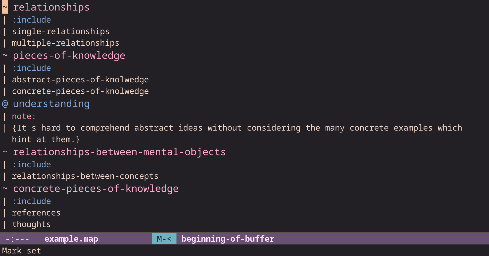

# concept.el

> Plain-text conceptual knowledge editor for Emacs

## Introduction

**Conceptual** knowledge is an often underappreciated third form of knowledge which underlies the more commonly studied **relational** and **procedural** forms of knowledge. Those more celebrated forms of knowledge answer the questions:

* What is the case?
* How does it happen?

The specifications for these more commonly studied forms of knowledge seem to come from nowhere, residing somehow in our heads. Their underlying genius often lost with the progression of time. After which, they need to be uncovered anew, often by fresh eyes.

Defining effective procedures or coherent relational databases requires firm grounding in domain knowledge. That knowledge is largely conceptual. It doesn't involve calculation, but it captures and organizes patterns in reality which we intuitively map inside our heads into our own verbal understanding. Thus, the conceptual form of knowledge could be thought of as answering the question:

* What does it mean?

In this computer age, **conceptual** knowledge is still largely captured in free-form documents such as scientific articles, school textbooks, and blog tutorials. While modern search tools powered by probabilistic models and advanced data structures can help us sort through such documents, this package proposes a radically different way of managing it: through porting it from a linear prose structure into an inherently recursive structure. This new structure closely reflects how we as humans think and learn verbally according to educational psychologies.

The text representation of this format is pretty straightforward. A concept map consists of a text file. For convenience, let's say its a text with a `.map` file extension. Inside of this text file are a series of *ideas*. An idea captures a group of closely related thoughts. There are two kinds of thoughts as far as conceptual knowledge is concerned. There are thoughts which form propositions meaningful inside of some system to thus construct our (often more or less erroneous) understanding, and then there are thoughts which ground our abstract understanding in facts, evidence, and educational materials.

Following this conceptualization of our thinking when we think conceptually, in `concept.el` the representation of every idea has two kinds of components: one which models our abstract conceptual understanding, and the other which facilitates capturing the concrete actionable details which illustrate our more grand notions.

In `concept.el`, every idea starts with a *focus* concept which starts a new idea as well as it's first component: the *relationship block*. This holds all the conceptual relationships relevant to the idea. The focus concept starts with a `~`. It can be thought of as analogous to the subject of a sentence. Then come one or more relationship groups which specify a common relationship, analogous to the verb of a sentence, under which comes one or more data concepts corresponding to the object of a sentence. Thus, a relationship block specifies a group of related conceptual propositions each with their own verbs and objects, but all sharing the same subject.

After a *relationship block* comes zero or more *resource blocks*. These contain one or more *attributes* which are largely analogous to *relationships*, except that the data associated with each attribute is often structured more traditionally, if far more briefly.

The example below gives the simplest possible idea. It has one resource block associated with it. It would still be valid if there were none. There doesn't have to be any, but adding them is recommended, especially in situations where there is ambiguity about what idea is being represented. In such an idea as the one expressed below, there is quite a lot of ambiguity!

```concept
~ things
| :include
| concepts
@ understanding
| note:
| {Concepts are things considered in the mind.}
```

The focus concept (subject) of the idea is on the first line. The relationship (verb) is on the second line. It creates a relationship group which holds the one data concept (object) on the third line. The fourth line starts the only resource block associated with this idea. The attribute is on the fifth line and it's expository data is on the sixth.

The weird and completely miraculous thing is that in practice, we humans hold many hundreds or thousands of ideas in our heads at any given time. So, correspondingly a concept map hold many many ideas combined together. The example concept map below is included as a file in the source code repository for `concept.el`.

```concept
~ things
| :include
| concepts
| relationships
~ things
| :include
| single-things
| multiple-things
@ understanding
| note:
| {Understanding is based on contrast.}
| idea:
| {SMT}
~ concepts
| :include
| single-concepts
| multiple-concepts
@ understanding
| note:
| {Concepts are things.}
| {Thus, these relationships are implied by SMT.}
| derived-from:
| {SMT}
~ relationships
| :include
| single-relationships
| multiple-relationships
~ concepts
| :include
| subjects
| objects
@ understanding
| note:
| {All ideas have one and only one subject.}
| {The subject is given first and indicated with a tilde: ~.}
@ understanding
| note:
| {In english grammar, a simple sentence has a subject, a verb, and an object.}
| {Here ideas correspond roughly to multiple related simple sentences.}
~ ideas
| :hold
| relationship-blocks
| resource-blocks
~ relationship-blocks
| :hold
| relationship-groups
~ relationships
| :include
| relationships-between-mental-objects
| relationships-between-physical-objects
~ relationships-between-mental-objects
| :include
| relationships-between-concepts
~ relationship-blocks
| :hold
| relationships-between-concepts
~ relationship-groups
| :hold
| multiple-objects
| :share
| single-relationships
@ understanding
| note:
| {Keywords beginning in colons signify the start of a new relationship group.}
~ resource-blocks
| :hold
| attribute-groups
@ understanding
| note:
| {Keywords ending in colons signify the start of a new attribute group.}
~ pieces
| :include
| pieces-of-knowledge
| pieces-of-intuition
~ pieces-of-knowledge
| :include
| abstract-pieces-of-knowledge
| concrete-pieces-of-knowledge
@ understanding
| note:
| {It's hard to comprehend abstract ideas without considering the many concrete examples which hint at them.}
~ concrete-pieces-of-knowledge
| :include
| relevant-concrete-pieces-of-knowledge
| irrelevant-concrete-pieces-of-knowledge
~ attribute-groups
| :hold
| concrete-pieces-of-knowledge
~ concrete-pieces-of-knowledge
| :include
| facts
| references
| thoughts
```

Take your time to read through that and I think you will find that this sort of knowledge capture is quite fundamental. It might seem egregious and unnecessary to be so explicit, but for advanced knowledge work explicitness is widely-recognized as a best practice. This is particularly true in highly multi-disciplinary situations where team members come with wildly different skill-sets and expertise collaborate together. So, why do you have this feeling? It is an alien way of working that is widely discouraged.

There is much to quibble about in the above concept map. It leaves a lot left unsaid and ambiguous. We certainly see that ambiguity, but the point here is to recognize that there is value in constructing large concept maps: they give us the hooks to (re-)organize our thoughts so that they can be productively criticized and improved upon.

It is only through criticism, preferably open criticism and preferably criticism we apply to our own thoughts, that help our thinking processes improve. Laying out all the conceptual ideas a team knows about the problem they are trying to solve can be a revelation for many people working together on a large project. We believe strongly that the best plan can only emerge once everyone on a team gains a comprehensive view of the possibilities before them for solving the problem at hand.

The text format used by `concept.el` is designed to be familiar and comfortable to people with experience writing a little bit of lisp code.  Concepts, resources, relationships, and attribute keywords are intended to be assigned identifiers which look like a readable subset of valid lisp symbols. This should be familiar to most people using Emacs as their editor. Once you accept this restriction on naming, you buy into a set of constraints which facilitate the creation of a bunch of very useful editing tools for making huge concept maps quickly.

These editing tools include:

* a variety of (full and partial) text-completion interfaces.
* a whole file scanning system giving an overview of all the conceptual elements used in a concept map provided through `imenu`.
* a document navigation and re-organization system provided through `outline` (like `org` mode) in addition to custom tools tailored for concept maps.
* buffer-wide data validation tools including a parser for concept maps implemented via the built-in `peg` parsing expression grammar library.
* hyper-linking to external documents, image files, and online documentation
* a data "following" tools which help the user ensure the map is meaningful by grounding it in concrete examples and references to external resources.
* a search interface and query language provided through `consult`.
* a minibuffer-based editing interface which provides data validation tools.
* An extensible menuing system for editing local variables holding lists of lists of strings that configure the behavior of a variety of concept map editing features including combinatorial conceptual relationship expansion and the scope of an interactive conceptual network analysis.
* a suite of useful template expansion functions which can be combined with packages like `tempel` to ease adding new resource and relationship blocks.
* an automatically synchronized network graph representation of the concept map holding all the conceptual relationships stored in the relationship block portions of the buffer.
* a suite of local network analysis tools useful for refining concept maps to make them more comprehensive.
* a suite of exploratory data analysis tools which collect data for studying the (sometimes spatial) distribution of ideas, concepts, concept-fragments, resources, and the relationships between them within a concept map.
* a suite of tools for standardizing the names of concept identifiers both within a single concept map as well as between multiple concept maps so that they can either readily be split apart or merged together.

These tools, bolstered when used in conjunction with external data analysis packages like R, combine to make it feasible to productively develop and explore concept maps which include millions of concepts, resources, and even more relationships between them.

## Installation

Install via ELPA (eventually!). Run M-x `package-install`. Press `ENTER`. Type `concept`. Press `ENTER`.

## Thinking about concepts

When you think about a particular thing, you use the singular voice: you speak of the cat in the alleyway and the mouse she is chasing. When you think about things in general you use the plural voice: you speak of cats in their acts of chasing mice and mice in the act of fleeing cats. When you follow this convention of naming concepts with plural words, you realize that concepts in English have names with three distinct components:

* a classification or categorization component
* a core concept component
* and a definition component

For example, consider the concept:

> abstract-pieces-of-knowledge

This concept can be broken down into:

```
class: abstract
core: pieces
definition: of-knowledge
```

Gaining an intuition for what this concept is about requires first understanding what is meant by knowledge, pieces, and abstraction. These are often best sharpened by finding their opposites or complements. That is also why scientists conduct comparative experiments. We best understand anything by constructing the boundaries in our minds for what they are and are not. The opposite of abstract is concrete or definite. A piece doesn't have an opposite. However, it has a complement: pieces have parts which make up the whole piece. A piece itself is often not used in isolation, but is merely a part of something greater. A piece of furniture is merely a part of the total interior design of a room. Finally, we come to the definition component. 

Definitions start with what linguists call *prepositions*. These are followed by optional adjectives on required qualities.

One of the most common prepositions is `in`:

```concept
~ people
| :include
| people-in-distress
| people-in-no-distress
~ people-in-distress
| :include
| people-in-mild-distress
| people-in-moderate-distress
| people-in-severe-distress
~ people-in-distress
| :include
| people-in-physical-distress
| people-in-emotional-distress
```

The quality here is distress. From a concept mapping perspective, we first lay out the quality with it's preposition. Here there is an optional negation before the preposition.

Another common preposition is `with`:

```concept
~ people
| :include
| people-with-diabetes
| people-with-no-diabetes
~ people
| :include
| people-with-a-job
| people-with-no-job
~ people
| :include
| people-with-a-nose
| people-with-no-nose
~ people-with-a-nose
| :include
| people-with-a-big-nose
| people-with-a-small-nose
~ people
| :include
| people-with-children
| people-with-no-children
~ people-with-children
| :include
| people-with-some-children
| people-with-many-children
~ parents
| :name
| people-with-children
```

Yet another common preposition is `that`:

```concept
~ animals
| :include
| animals-that-reproduce-sexually
~ animals-that-reproduce-sexually
| :include
| animals-that-make-sperm-cells
| animals-that-make-egg-cells
~ male-animals
| :name
| animals-that-make-sperm-cells
~ female-animals
| :name
| animals-that-make-egg-cells
~ animals
| :include
| male-animals
| female-animals
~ plants
| :include
| male-plants
| female-plants
~ species
| :include
| animal-species
| plant-species
| fungal-species
| bacterial-species
~ female-animals
| :include
| female-animals-that-lay-eggs
| female-animals-that-give-birth
~ female-animals-that-lay-eggs
| :include
| female-animals-that-can-lay-eggs
| female-animals-that-cant-lay-eggs
~ female-animals-that-can-lay-eggs
| :include
| female-animals-that-will-lay-eggs
| female-animals-that-wont-lay-eggs
~ female-animals-that-give-birth
| :include
| female-animals-that-do-give-birth
| female-animals-that-dont-give-birth
~ female-animals-that-do-give-birth
| :have
| pregnancies
```

Yet another common preposition is `of`:

```concept
~ parts
| :include
| parts-of-speech
~ pieces
| :include
| pieces-of-paper
~ pieces-of-paper
| :include
| pieces-of-paper-with-a-standard-size
| pieces-of-paper-with-no-standard-size
~ sheets-of-paper
| :name
| pieces-of-paper-with-a-standard-size
~ sheets
| :include
| sheets-of-paper
~ sheets
| :include
| sheets-of-metal
~ books
| :hold
| sheets-of-paper
~ books-that-were-printed
| :include
| books-that-were-printed-on-paper
| books-that-were-printed-on-vellum
~ pieces-of-paper
| :include
| pieces-of-scratch-paper
~ people
| :include
| people-of-sound-mind
| people-of-unsound-mind
```

Here are some more prepositions we tried to place into related groupings:

* association: about, of, with, among
* relation:    against, for
* proximity:   near, by, around
* movement:    from, to, across, past, into, onto
* position:    above, below, behind, ahead, under, over, beyond
* location:    in, on, off, at
* time:        during, since, until, after, before

This introduction really only scratches the surface. There have been many semantical theories about prepositions proposed by linguists. We are not experts. We defer to the experts to the degree their tools are readily graspable and useful to us. As an English speaker, we already grasp much of the semantics of prepositions intuitively. From the perspective of concept mapping, our goal is merely to find the "good parts" of English from which we can clearly represent the concepts we want to think about, but in a way which also supports simple computational schemes which allow us to comprehensively understand our concept maps.

A proximate goal of concept map making with a simpler vocabulary is to help ourselves think more clearly right now. Complicated language often both conceals the possibilities of our thinking and limits who we can collaborate with. Simple language reveals the essence of our verbal reality, and facilitates the composition of ideas together. It also makes searching for related ideas easier. It makes vector database search less useful when the vocabulary of the concept map is composed of more frequently used simpler fragments from which various statistical analysis approaches can be readily applied based on computationally inexpensive geometric techniques which can be run on ordinary hardware like principal components analysis and it's generalizations which handle both categorical and quantitative understanding simultaneously, along with varying amounts of "missing" data.

An ultimate goal of finding the "good parts" of English, is making it easier to find appealing between-map canonical representations of concept maps. We have already discussed the needs of within-map canonical representations: consistent ordering of conceptual elements, and a consistent vocabulary within a map. For between-map canonicalization, we need consistent vocabulary across possibly many maps. Establishing such a way of "speaking" English which enables this desirable outcome is why this subject is being discussed and considered here. It is in scope for data analysis in the future.

Knowledge concerns successful prediction. Ignorance means almost assuredly unsuccessful prediction. Once you think about a concept this way, it's name alone suggests that a whole concept map supports it. We invite you to take a stab it at. We took some time to do this exercise and got a pretty substantial concept map out of it.

In `concept.el` we encourage you to put the classification piece on the left, the core piece in the middle, and the definition piece on the right. Further, it's better to start with the core plus some definition. Then, once you have your definition, you can added a category which alludes to that definition via and `:name` relationship.

```concept
~ beings
| :include
| beings-that-die
| beings-that-never-die
~ mortal-beings
| :name
| beings-that-die
~ immortal-beings
| :name
| beings-that-never-die
~ beings
| :include
| immortal-beings
| mortal-beings
```

Redundancy isn't too much of a problem since the goal is that you deeply understand what you are talking about and that you can gain that understanding quickly by exploring a concept map generally paired searching through a concept map specifically, along with validating your assumptions by exploring both narrowly within ideas, and widely between collections of related concepts.

To facilitate this, among other features, `concept.el` provides an implementation of the longest common sub-string algorithm to help build tools for automatically identifying these components. This can be combined with the string-distance procedure and tools which provide you a list of all concepts in the buffer to find likely core concepts. Of course, really discovering this will often require a degree of standardization which is not yet really possible with Emacs, but should be feasible from a dedicated data analysis environment like R.

## Navigating through concept maps

Concept maps inherit from `outline-minor-mode`. This gives a whole suite of keyboard shortcuts and `M-x` commands which automatically work with concept maps. Navigating up and down outline heading elements is implemented with `M-n` and `M-p`. In `concept.el`, there are two headings `~` and `@`. Otherwise, you can press `C-<up>` or `C-<down>` to move quickly across additional levels of concept maps including *relationship groups*, *attribute groups* and their corresponding data elements (data concepts) and (expository data). Finally, `C-M-<down>` and `C-M-<up>` let you fly across different elements of the same type.

Did I say 'finally'? I lied. You can also press `C-c C-n` or `C-c C-p` for a more advanced contextual method of navigating through concept maps. These commands have modally defined behavior depending on the value of global variables `concept-last-relationship-group-size-behavior` and `concept-last-attribute-count-behavior` which chooses between the modes `"all"`, `"unique"`, and `"diff"`. These options analyze each idea and compute statistics summarizing interesting aspects of the idea.

This can be useful for finding ideas or resources with certain interesting features. For example, you might want to find ideas with conceptual *relationship blocks* having two relationships instead of one. To do that, place your cursor on the nearest subject line. Then press `C-c C-n`. You will be prompted for the number of objects you want there to be since there is one relationship for each subject-verb-object triple.

If you want to look for ideas with a certain number of relationship groups, press `C-c C-n` from a relationship group line. Similarly, if you want to go forward to the next resource group with a desired number of data lines, place the cursor on a resource line.

Leveraging the line-oriented tools in `consult.el` can be another very effective way of exploring a concept map. So can vanilla forward `C-s` and backward `C-r` text searches. Later we will discuss some more powerful block-aware search tools that can be very convenient when the line oriented search tools just don't cut it.

For navigation within an idea, the commands `concept-forward` bound to `C-M-f` and `concept-backward` bound to `C-M-b` can be helpeful. However, the standard text cursor motions are always available and unchanged inside of a concept map.

## Editing tools for concept maps

`concept.el` provides a wealth of tools for both rapidly entering new ideas and rapidly editing existing ones. We believe that for concept maps to become the best learning tools they can, we must be able to write programs against their data. When we analyze the result of the program, we quickly learn whether our data is capable enough to support it. To be able to write programs, concept maps must be both internally consistent and comprehensive. Internal consistency minimizes the need to deal with special cases. Comprehensive concept maps hold the information we want to query in the first place. If we just stuck to the ordinary plain text editing regime provided out of the box by most text editors, concept maps stay as "write only" constructions. There are good tools to enter some usually small amount of data, and displaying it in a pretty graphic, but only limited support for reorganizing it. We feel that a good design should be both "read and write", and provide extensive support for editing the concept map and rapidly changing it. Being text based, these changes can be tracked with the assistance of version control systems like `git`.

In a regular text buffer, pressing `C-o` in vanilla Emacs executes `open-line` which opens up a new line above the current one. `M-o` is undefined, but it made sense to me that analogous to `C-o` it should also open up a new line. Since above the current line was already taken, `M-o` should open something up below the current line. However, it also made sense to me that it should do something with the previous data. This part is confusing it retrospect. However, when filling out resource blocks this aspect can save some time and ease the standardization of language used across different concept maps, making them more easily compared.

You need a way to insert text both within blocks and between blocks. For relationship blocks insertions between blocks are more useful than insertions within the blocks, while within resource blocks it's the opposite. We've found that in resource blocks, the different attribute groups take a far more prominent role, atleast when getting your ideas down initially. This tension challenges the desirable goal of following the principle of least surprise.  To minimize that tension, you sometimes need to press `C-u` first in relationship blocks to get similar behavior as you would see in resource blocks.

Open the `example.map` concept map included in the git repository. Navigate to the beginning of the buffer with `M-<`. Then press `C-o`. This makes a new idea block by creating a new subject line. Type out `stuff`. Then, press `M-i`. This inserts an `:include` relationship and creates an object concept line. Press `M-i` again and it will enter `stuff` again automatically. `M-.` will do the same, while `C-M-.` will add the following subject instead.



The difference between `M-i` and `M-.` is that `M-.` and `C-M-.` will always enter these concepts, while `M-n` does different things depending on where on the line or where in the idea you are. It tries to help you do what you mean, while `M-.` tries to be specific. Enter `cool-stuff` by moving the cursor to the beginning of the concept. This can be done with `C-M-b` which is a built-in editor shortcut for `backward-sexp`. Otherwise you could just type `M-b` repeatedly until you get there. Now type out `cool-`. From hear you can type `M-i` and it will make a new line for you. Now type out `hot-` followed by `M-.` to write `hot-stuff`. Now press `M-o` to make a new subject line filled in automatically with `hot-stuff`. Press `M-i` again and type out `very-` followed by `M-.` to write `very-hot-stuff`.

Now type `M-o` again to make a new subject line automatically filled out with `very-hot-stuff`. Now press `M-i`. Now press `M-1 M-.` to enter `stuff`. Now complete it with `-that-has-many-layers`. Therefore, you have typed out `stuff-that-has-many-layers`. Now press `M-i` followed by `C-.`. `C-.` inserts the last object line instead of the last subject line. As you might imagine, `C-1 C-.` inserts the last word of the last object, just as `M-1 M-.` inserts the last word of the last subject. Note that if you had instead asked for `M--1 M-.` you would have gotten the first word of the last subject. Similarly, `C--1 C-.` would give you the first word of the next subject.

While not relevant to this example, when seeking to insert an arbitrary concept, it makes to press `C-c .` or `C-u C-c .` to make insertions starting from a customizable menu of data sources. On first use, it defaults to selecting from the existing concepts in the map. However, on subsequent use it could also be other functions based on `completing-read`, that  complete from candidates of all Emacs Lisp commands, functions, or variables, or shell commands, or environment variables, and anything else the user is interested in investigating.

Now press `C-s many` followed by `M-DEL` to kill the word `many`. Replace it with few. Now press `M-i` again. Toggle it into a subject concept by cycling the first character with `M-r` until it is a `~`. Now press `M-.` to insert the previous subject. When you are new to concept maps, all these different keybindings may be confusing and a bit hard to remember. So, `concept.el` provides a simpler alternative. Navigate to the beginning of the line with `C-M-b` and kill the rest of the line with `C-k`. Now press `TAB` and filter down to the last concept just by typing under the completing-read selection is the concept you want.

Note that just like with resources, you could also auto-complete against all *relationship blocks*. Just press `C-c y c` on a new line between existing ideas.

When developing concepts, whether starting from a blank slate or from an already sprawling base with thousands of existing concepts, it helps to have a small tailored suite of powerful frameworks at your fingertips. These frameworks are ideally conceptualized as distinct actions you can take. In `concept.el` that means the editing commands are grouped into a small number of keybindings that you make over and over, and those keybindings help you fall into a pit of success. We are still working on good names, but they are right now:

* insert conceptual elements
* kill conceptual elements
* split up blocks
* isolate regions in blocks
* combine regions in blocks

The primary keybindings for editing concept maps are clustered on the right side of the keyboard on `o`, `;`, `.`,`[`, and `]`, with combinations of `C-`, `M-`, and `C-M-` performing different variations of the core editing tasks.

## Making abstract ideas concrete with resource blocks

You can enter *resource blocks* by typing @ on a new line (e.g. created with `C-j`  or by `M-j` (or even `M-i` in many cases) followed by `M-r` to cycle until a `@` appears. Alternatively, if you want to start from an existing resource, you can press `C-c y r` to auto-complete across all existing resource entries. Once you have a resource block, you can navigate through and edit them with `M-i` which does useful things for whatever situation the cursor is in. When you want to edit the parent keyword for your attribute group, you can press `C-c e` on your attribute line and the cursor will move back to your keyword and delete it. If that is not what you want, then you can undo with `C-x u`. In that case, after the undo you might just want to press `TAB` to see what the other keywords are in your concept map and select one of those.

If you are on an attribute keyword, you can press `C-<down>` and it will move you inside of the delimiters of the next piece of attribute data. If you want to edit that piece of data, press `C-c e`. If instead you want to edit it's group, press `C-u C-c e`. Really, this sort of editing seems pretty intuitive for concept maps, so we have made it work everywhere. Navigate to any line in the concept map and you can edit it with the same `C-c e` and `C-u C-c e` keybinding and it will work as you expect. The main downside of the minibuffer editing interface is that it doesn't have access to the rich completion sources available in the buffer via `TAB` and `M-/`. They could be added, but instead you get a dedicated history.

It can be very convenient to use (e.g. tempel or tempo) templates to insert *resource blocks*. In my `init.el` configuration file I have bound the following tempel configuration for concept maps.

```elisp
(defun tempel-setup-capf ()
  (setq-local completion-at-point-functions
              (cons #'tempel-expand completion-at-point-functions))
  (add-hook 'conf-mode-hook 'tempel-setup-capf)
  (add-hook 'prog-mode-hook 'tempel-setup-capf)
  (add-hook 'text-mode-hook 'tempel-setup-capf))

(with-eval-after-load 'tempel
  (define-key concept-mode-map (kbd "C-c t") #'tempel-expand)
  (define-key concept-mode-map (kbd "C-c n") #'tempel-next)
  (define-key concept-mode-map (kbd "C-c C-c") #'tempel-done)
  (define-key concept-mode-map (kbd "C-c p") #'tempel-previous))

(require 'tempel)
```

You can use `M-i` to make new attribute group keywords. However, by default these show up as `note:`. You'll have to edit these using either standard text editing commands or via `C-u C-c e` which calls a minibuffer editing interface. The standard way involves typing `C-r note:`. Press `ENTER`. Now press `C-M-k` to delete the whole name for sure. However, in this case `M-d` would work just as well. The minibuffer editing interface provides the advantage of validating the input for you and rejecting your change if it doesn't match. However, it has the disadvantage that you cannot just hit `TAB` or equivalently `C-M-i` and get ubiquitous text completion.

Reorganizing existing attribute groups, or expository data lines can be done with `M-<up>` (up arrow key) and `M-<down>` (down arrow key). The same commands also work for (conceptual) *relationship blocks*. This is the more manual way of reorganizing the elements of a concept map. There is also extensive support for reorganizing concept maps in a more automated way. Of these, there are four main arcs planned:

* alphabetical sorting (`C-c C-a`)
* custom canonical sorting (`C-c C-o`)
* reverse ordering (`C-c C-r`)
* random shuffling (`C-c M-r`)

The point of all this functionality is to implement a canonical ordering for a whole concept map. With such an ordering, it becomes feasible to get a clear diff between two variants of nearly the same concept map. This avoids the problem of meaningless reorganization tasks masking vastly more important meaningful changes. Remember, the whole point of investing in concept mapping is to engage in and share meaningful learning! Canonical sorting is a crucial step towards this goal.

Why then is there a random shuffling feature? One use case for shuffling the conceptual elements in a concept map is to test that the canonical sorting procedures work as intended no matter what. There are a lot of situations to test, and in the beginning it will be hard to know which situations are more important to check. Thus, it's pretty useful to simulate a lot of situations randomly to see if there are edge cases which haven't been covered yet.

## Identifying "smelly" ideas

One way an idea can smell is if it cannot be canonically sorted. A major challenge to the notion of canonical sorting for concept maps is figuring out what to do with the following situation. Look at the snippet from our `example.map` concept map we have been discussing previously below. Note that under the current logic, a canonical sorting of the concept map by our current scheme is impossible. There is an ironclad guarantee that if we keep randomizing the concept map, eventually we will not be able to recover the same sorting, at least not with purely alphabetic sorting. The only potentially canonical sort we see is to first sort by resources alphabetically, and that only works if we can do a lexical sort, where we conditionally sort by alphabet, then length, and then we need to further sort on something else such as the length of the shortest or longest lines in the attribute data.

```concept
~ concepts
| :include
| objects
| subjects
@ understanding
| note:
| {The subject is given first and indicated with a tilde: ~.}
| {All ideas have one and only one subject.}
@ understanding
| note:
| {Here ideas correspond roughly to multiple related simple sentences.}
| {In english grammar, a simple sentence has a subject, a verb, and an object.}
```

The example above demonstrates a rapid increase in complexity necessary to canonically sort concept maps. This is not remotely desirable. We could further restrict concept maps to have unique names at each grouping level. Unfortunately, this too seems undesirable since the whole point of concept mapping is to better process the ideas you are exposed to. If ideas concern the same subject, then they should have the same focus line.

Given the complexity of the problem concept maps are trying to solve, probably the best solution is to study failures of canonicalization case by case. In the example above, it seems odd that the second resource block is even included with this idea about concepts. It is probably better suited for belonging to an idea focused on ideas themselves. When you do that, the problem goes away for this concept map. The above thought experiment suggests the heuristic rule that if you need two resources with the same name in the same idea, then you should consider moving one of the resources to a new idea.

The just discussed situation, prompts us to consider how a researcher might discover such smells in their own concept maps. Earlier in this document, we discussed how the behavior of `C-c C-n` depended modally on the value of global variables `concept-last-relationship-group-size-behavior` and `concept-last-attribute-count-behavior` which chooses between the modes `"all"`, `"unique"`, and `"diff"`. A third global variable `concept-last-resource-count-behavior` controls the how resource counts are made. The effect of changing it's value can be seen when running the commands `concept-goto-next-relationship-block-with-resource-count` or `concept-goto-previous-relationship-block-with-resource-count`. A fourth global variable `concept-last-size-comparison-behavior` taking values of `=`, `<=`, and `>` control how the size comparisons are made with these commands. In aggregate, these commands help the concept mapper discover smelly ideas that they have already created, but for which they cannot intelligibly perform a search query on because these aspects of an idea are concept and grouping name agnostic.

## Following the data in a resource block

Once you have your *resource block* written with all the information you want, it sure would be nice if that data could be worked with directly in the concept buffer. That is exactly what the `follow` interface is for! Pressing `C-c f` can be used on exposition lines inside of resource block out of the box. At this point there are numerous special keywords available, but let's first talk about those most useful for referencing documentation:

* `file:` to open other files
* `url:` to open web pages in an `EWW` buffer
* `info:` to open info documentation
* `man:` to open man pages

Of these, the most interesting by far is `file`. Thanks to the Emacs add-on package `pdf-tools` and a bunch of built-in image support in Emacs proper, many file formats can be viewed and even editing directly inside of an Emacs buffer. However, thanks to lots of support builtin to Emacs for handling email attachments, `file:` also can be used other kinds of files you wouldn't open with Emacs. If the file path given under a `file:` keyword cannot be intelligibly opened from within Emacs, `concept.el` will try to open it with M-x `mailcap-view-data`. This will consult your `mailcap` file if it exists. Note there is an environment variable `MAILCAPS` which may be helpful to read about. Here is an example part of a mailcap file.

```
video/*; mpv -- %s
audio/*; mpv -- %s
```

That is enough to tell `concept.el` how to open dynamic multimedia files with `mpv` in an external process. Otherwise, the Emacs MIME machinery will look at the Emacs variable `mailcap-user-mime-data`. Below is an example Emacs variable which tells Emacs how to open a video file with the `mpv` shell command.

```elisp
(setopt mailcap-user-mime-data
        (list (list "mpv -- %s" "video/.*")))
```

There are a few situations where you would want to further modify the semantics of viewing or editing a file. For this, multiple attribute keywords can combine together to capture rich interactions. There are two kinds of these keywords: modifier keywords and indirect keywords. Modifier keywords will make more sense when we discuss keywords for interactive code evaluation in a concept map buffer. A few indirect keywords, are however, pretty helpful for working with documentation.

One of them involves the combination of a PDF file and a page number. So, when inside a resource block with a `page:` or `pdf-page:` keyword (sometimes the stated page and the PDF page are different and sometimes that's important!) and a `file:` keyword, and the attribute under that `file:` keyword is a PDF file, then pressing `C-c f` on the attribute under the `page:` keyword will open the PDF file, and then navigate to the given PDF page. Similarly, a variety of other plain-text files take `search-phrase:` queries which open those files, go to the beginning of the buffer, and then search forward to the first match of the search phrase. Alternatively, for larger documents it's more interesting to see a hole `occur` buffer for that search phrase. `line:` and `point:` are other indirect keywords which modify how `file:` works. Where it makes sense, these also exist for other documentation sources like `man:` and `info:` keywords. To implement these, the package provides wrappers around asynchronous systems behind `man:` and `url:` to make them seem synchronous for easy scripting of actions.

With indirectly followed files, it becomes all the more important to make sure that resource blocks have enough information in them to make them work. Often on a first pass it is tempting to be lazy and leave out some needed attributes. This is where leveraging the optional `first-match-only` arguments to the search interface come in handy. These allow for efficient keyboard macros to be written that fill in the missing keywords and attributes.

Sticking to the topic of documentation, there is also integration with the Emacs online documentation tools including the help system. The following keywords help document Emacs-specific topics.

* `emacs-symbol:` to run M-x `describe-symbol`
* `emacs-package:` to run M-x `describe-package`
* `emacs-keybinding:` (or `kbd:`) to run M-x `describe-key`

In addition, attribute data under the following keywords can be followed leveraging common Emacs facilities:

* `emacs-buffer:` to run `switch-to-buffer`
* `emacs-command` (or `M-x:`) to run `call-interactively` on the interned data
* `emacs-lisp` (or `elisp`) to run arbitrary Emacs Lisp expressions

Of course, running Emacs commands and lisp code can be dangerous. Use responsibly! Emacs Lisp expressions output their results into a dedicated buffer which can be readily changed into a subset of Markdown called Gemtext. So, you can easily change this to buffer from special mode into Markdown or Gemtext, whichever you prefer!

There is also support for running arbitrary shell commands through a wrapper over the Emacs M-x `compile` system. This is accessed through including a `shell-command` or `shell` keyword. These use the builtin Emacs package `ansi-color` to hold the same nice colors you would see in a dedicated M-x `shell` buffer.

Both `emacs-lisp:` and `shell-command:` support the `directory:` modifying keyword which changes the directory in which commands are run. `emacs-lisp:` additionally supports `emacs-buffer:` as a modifier keyword which changes which buffer the code is run in. For shell commands that involve interactive prompts, there is a `prompt:` modifier keyword which switches on the comint feature of M-x `compile` so that those work, while in `emacs-lisp:` there is a `side-effects:` modifier keyword which skips all of the Gemtext reporting in favor of just getting some interesting side-effect like opening up notmuch and reading your email.

There are a lot of opportunities for extending the `follow` functionality for specific research applications. Note that we have really just scratched the surface of what could be useful. Right now, there is preliminary dired integration through the `file-path:` keyword. Please send in your ideas for what kinds of keywords might be useful for your research!

## Searching through concept maps

There is one hard dependency not provided out of the box with Emacs: the `consult.el` package on ELPA. Many of the commands in `consult.el` are useful in their own right for exploring concept maps: `consult-line` in particular, but that can only search across individual lines. In `concept.el`, the underlying functionality of `consult.el` is used to implement a convenient interface for searching through conceptual relationships and supporting resources at the block level. `C-c s` starts searches across conceptual *relationship blocks*, while `C-c C-s` starts searches through *resource blocks*.

Both search interfaces feature a query language based around triples. Conceptual *relationship blocks* have an additional simpler query language which makes finding ideas that involve certain combinations of phrases anywhere inside of them easy. Take for example the query below which matches 3 ideas from the concept map example shown above in this document. Note that the `@` signals `DO NOT MATCH`.

```
concept;relationship;@group
```

The subjects for those matches are:

```concept
~ things
~ relationships-between-mental-objects
~ relationship-blocks
```

An example of a relationship search would be:

```
~@include
```

This matches the 6 ideas that don't have `:include` relationships. Note the single `~`. This means that the subject and object concepts can be anything. Again, the `@` means `DO NOT MATCH`. Here is a more involved example query.

```
block~hold~group
```

This matches the ideas about `relationship-blocks` and `resource-blocks`. The related query below should give the same matches as this one. The only difference is that it allows the subject to be anything.

```
~hold~group
```

We can further allow the relationship block to be anything, and on this simple concept map we get the same answer.

```
~~group
```

The *resource block* queries work just the same as these relationship triple queries. The query below finds all the `understanding` resources with `note:` keywords:

```
und~no
```

It could be tightened by leveraging anchors. `^` means that the name starts with `u`.

```
^und~^no
```

It could also be tightened by adding more clauses to the query. This is done via adding a `:` clause separator. You can use as many clauses as you need.

```
und~no:~from$
```

This one only matches the one idea with a `derived-from:` keyword. The `$` means that the name ends with `m`.

By pressing the `C-u` prefix before `C-c s` or `C-c C-s`, the search interface will show only the first match in the buffer. This variant is very useful for editing. As an example imagine that you are studying On the Origin of Species by Charles Darwin published in 1859 and thus in the public domain. You will naturally make a lot of references to the book as you read. In your haste to make note of all the interesting ideas in the book, you might leave off documenting the location of your book on your file system. This is precisely where the `C-u` prefix comes in handy. Consider the concept map fragment below:

```concept
~ mechanisms
| :include
| evolutionary-mechanisms
~ evolutionary-mechanisms
| :include
| evolutionary-mechanisms-based-on-natural-selection
@ document
| book:
| {Darwin1859}
| file:
| {book/on-the-origin-of-species.txt}
| search-phrase:
| {strange pecularities}
| chapter:
| {4}
~ creatures
| :include
| creatures-that-cannot-see
~ creatures-that-cannot-see
| :include
| creatures-that-live-in-caves
@ document
| book:
| {Darwin1859}
| search-phrase:
| {caves of Styria and of Kentucky}
| chapter:
| {5}
```

Now type `C-u C-c C-s` and the query:

```
doc~book~Darwin:doc~@file
```

This will take you to the first fragment without a file. If you have the file already in your `kill-ring`, you can select it with `M-y` which I have bound to `yank-pop`. That lets you find the same clipboard entry over and over reliably. This approach works quite well in conjunction with defining keyboard macros with  `C-x (` and `C-x )`. Once you have a macro defined which adds the file to one resource block, filling them all in becomes nearly effortless via `C-u 0 C-x e` which repeats the keyboard macro over and over until all relevant resources have been edited. This way, it's easy to make several hundreds of edits in a minute or so.

## Checking the concept map syntax

Execute `C-c C-v` to check whether your concept map conforms to the expected concept map syntax. If it doesn't, it will move the cursor to the first violation. Once you are familiar with the syntax of concept maps, it is usually obvious what the problem is and you can fix it. Once it's fixed, you can press `C-c C-v`, make your new fixes, and repeat until finally the command places a message in the minibuffer that the syntax now parses.

Once the concept map parses successfully, searching should be guaranteed to work as intended and you should be able to run M-x `concept-map-export-to-table` or press `C-c C-t` to construct a tab-separated table which you can save to disk and then load into another tool like the `conceptuel` package in R. You can also take the generated preliminary exported table buffer `*concept-map-export*` and run M-x `concept-table-export-to-gexp` which will produce a `*relationship-export-gexf*` buffer which can be saved as a GEXF (XML) file and then loaded into the Gephi interactive network analysis program. However, note that currently only the concept map part of the network survives in this step. None of the resource block data is saved in the GEXF file as of yet. Further note that creating the GEXF export can be rather time consuming for large concept maps. Expect it to take a minute or two.

## Future Plans and Related Projects
### Tools for interactively sorting and resorting concept maps

There are two sorting systems in more or less parallel development for use in probing concept maps: the slow O(n²) partial sorting system and the efficient O[n⋅log(n)] heap-based sorting system. The partial sorting system was developed first since it could be implemented with only the ability to swap two adjacent elements. That functionality was available for ideas via tools provided by the built-in outline minor mode. However, as you can imagine it is quite slow for larger maps. From the tests that we have done so far, tens of millions of swaps can be needed for moderately sized concept maps. At that point, our infrastructure for analyzing concept maps was much less mature than what we have now. 

However, after we implemented randomization tools, it became possible to make arbitrary exchanges of elements throughout the buffer. This allowed us to create an implementation of a heapsort algorithm for sorting ideas. We have so far made one successful sort of a fairly large concept map greater than 14,000 lines in under 20 minutes, although we haven't done in-depth timing studies yet.  We will investigate this path forward further to see if I can get any easy speedups.

To be honest, we have not pushed hard enough on the built-in sorting functionality like `sort-lines` and it's underlying `sort-subr` interface. We only just discovered the latter. It may be the fastest way of sorting everything we need. It will be interesting to compare it's performance with our heap-sort implementation for sorting ideas in large concept maps. We hope to find an approach which takes under a minute or ideally only a few seconds.

We are still working towards finalizing the partial (bubble) sort implementation of the full alphabetic sort system. It seems like it's getting stuck in the last idea of the concept map. We need to take some time to debug that.

### Tools for setting up canonical sorting schemes for concept maps

Concept maps should be meaningful to many people, not just their creators. To make that a reality, `concept.el` should gain features which make it easier to merge two concept maps together. One possible way this could be done is through achieving a canonical ordering of ideas based on their subjects and possibly their length. Some code to this effect has already been included, but it is not completely functional. However, it's shaping up to look like there will be interactive commands for sorting, reversing, and randomizing the order of all meaningful elements inside of concept maps. When it comes to sorting, currently we are aiming for alphabetic sorting to start. However, it seems like a good idea to aim for a fully custom canonical sorting system with the possibility to enable the user to provide one or more custom sorting methods as well so that what is canonical can be chosen by what makes sense for the research application. For example, alphabetic sorting doesn't make much sense for attribute group keywords. I have noticed that I frequently create FAQ style resource blocks and I am not particularly interested in reading ones like:

```
@ understanding
| answer:
| {4}
| question:
| {What is 2+2?}
```

The first implementation will be based around the idea of configuring the canonical sort in terms of 25 possible algorithms, or more like 12 possible algorithms each with it's reverse as well, along with one custom algorithm. The way this is done seems general enough in practice. More complicated canonical sorting can be achieved through providing helper functions to quickly create a custom sorting procedure. One easy extension I thought of was an alphabetical sort where certain reserved keywords get shown first in the given order while the remainder are sorted alphabetically. This captures the `answer:` followed by `question:` problem.

Another interesting pair of orderings looks at the length of the elements themselves. These would be analogous to the list sorting calls show in the block below. An advantage of looking at these orderings is that they can reveal a natural separation between the most fundamental concepts and the more derivative ones. And if there is a well defined canonical sort defined for taking diffs of the concept map, then it really doesn't matter from the perspective of tracking and merging changes. You can radically change the ordering of the concept map file over and over again and it doesn't matter since the meaningful contents have not changed.

```
;; Shortest to longest with alphabetical tie breaker
(sort (list "z" "az") (lambda (a b) (let ((A (length a)) (B (length b))) (or (< A B) (if (eq A B) (string< a b))))))
;; Longest to shortest with alphabetical tie breaker
(sort (list "z" "az") (lambda (a b) (let ((A (length a)) (B (length b))) (or (< B A) (if (eq A B) (string< b a))))))
```

### Followable information

It would be really nice if the *follow* interface made such information clickable with the mouse and underlined to distinguish it from other pieces of attribute data which cannot be. This would provide a handy visual cue which would help new users better grasp the possibilities of the follow system. I've worked with clickable links in the past and have noticed they can really slow things down when applied to whole buffer. The trick then seems to be to restrict the clickable links to the visible region and recompute as that region changes. It should be something like:

```
  (add-text-properties
     beg end
     `(keymap ,map
       mouse-face highlight
       help-echo "Click or press `C-c f'"
       action concept-follow-dwim
       follow-link t))))
```

We have some notes on this problem and hope to get to it eventually after we have managed to bring up the main system. We also discovered that there is a built-in minor mode for making URLs clickable. We might build on top of that minor mode to make it recognize file paths as well.

We are also working on integrating the Emacs calendar and diary features into the following system. However, there is a trick to getting fancy views of custom diaries we haven't found yet.

In the future we would like to add similar integration for the R/ESS system that we have for Emacs Lisp including session support if possible.

### Network analysis

We're working towards having a reliable and scalable background process which keeps an up-to-date graph representation (implemented as a hash table) of the concept map in memory and available for performing basic network analysis operations on command. These operations include basic facilities for detecting network dependency cycles and finding paths linking two concepts. We have also implemented procedures for finding hypernyms and hyponyms.

Hypernyms are the most general subsuming concepts, while hyponyms are the most specific subsumed ones. We plan to extend these tools with variants which see all root hypernyms and all leaf hyponyms (or those at the top k) inside of tabulated-list buffers sorted by their depths relative to a starting concept, and resortable given the tools provided by tabulated-list mode. 

Being able to see all immediately subsuming or subsumed concepts at a glance from a particular starting concept is already feasible via the consult-based search interface, but it may also be interesting to find them automatically from the network and place them into a similar tabulated list buffer. We can imagine there are many such opportunities for leveraging a tabulated-list mode buffer. Thus we expect to make frequent use of them.

Finding the most novel concepts in a concept map can suggest areas to focus on if possibly only to move those concepts to a different map. We might gauge the relative novelty of a concept according to the depth of its deepest hypernym. More novel concepts will have shallower depths, while more derivative concepts will have deeper ones. 

We can scan the network to find the top k concepts with the smallest hypernym depths. Similarly, we might scan the network to find the top k concepts with the largest hypernym depths in order to find the more established concepts in the concept map. Another gauge of isolation is the total number of hypernyms. The fewer hypernyms a concept has, the more isolated it is. Remeber, in Ausibel's theory, learning is the process of connecting what you don't know to what you do. So, counting hypernyms seems a pretty intuitive measure of learning from that perspective.

Similarly, the more hyponyms a concept has and the deeper those hyponyms are, the more fundamental that concept is to the concept map. So, it can be quite interesting to see at a glance the top k concepts which have the largest number of hyponyms or the greatest depths to their most distant hyponyms. We imagine that most concept maps will have something akin to a power law when it comes to their metrics with a relatively few number of very fundamental concepts and large number of concepts with almost no hyponyms whatsoever.

In addition to studying a concept map in terms of hypernyms and hyponyms, it's interesting to pick two concepts and find their latest common subsumer (LCS): a metric analogous to the least common multiple in discrete arithmetic. Concepts might be judged more closely related to each other the lower the depth of their shared LCS is.

Finding a concept's widest branching subsumer(s) is another interesting procedure from concept map analysis. It is interest to see both the widest, and the top k widest branching subsumers. Thus, this tool will also deserve an associated tabulated-list buffer. Studying these subsumers can give a learner a sense of how the current concept relates to the overall concept map.

For what is functional, the few network analysis tools we have do seem to work. However, they are incomplete in that we really need to develop and integrate the tabulated-list mode query views for command variants than should report more than one concept ranked by a depth or a count. 

Another core piece of functionality missing from the network analysis tools is the ability to recompute the network only the fly after optionally excluding relationships where user-supplied predicates are triggered based on either their relationships or their containing concepts. Ideally, there will be two buffer-local variables which pick either custom functions, custom inclusion/exclusion lists, or regular expressions for readily filtering what data makes it into the constructed network graph. Maybe we need a third variable to decide whether those variables should be treated as inclusive or exclusive? 

These network analysis tools discussed above should be quite helpful to learners who seek to take their concept maps to the next level of comprehensiveness and refinement. Of course, Emacs cannot do everything here and exploring more advanced possibilities for analyzing concept maps via more advanced network analysis algorithms is where we aim to focus our time with the conceptuel R package. However, that doesn't rule out implementing an Emacs subsystem for exposing network analysis tools for concept maps developed in R particularly convenient for Emacs users.

### Incremental updating of conceptual relationship networks

Our Emacs-based network analysis interface is currently pretty fresh, largely incomplete, and not yet as scalable as it needs to be. To be scalable `concept.el` needs a network updating system that is largely invisible to the user, but which works both extremely quickly and reliably to keep the hash table in-sync with the `source` buffer. Thus, enabling network analysis algorithms to be employed to study and further improve the concept map. Network-based queries against the concept map should just work almost a immediately on new entries (after they are saved), and updates should not cause disruptions during the concept map editing (or composition) process which break the user's concentration.

An early high level question during development of the incremental updating system was:

> when is it more productive to incrementally update the graph rather than to recompute it from scratch?

This question may no longer make much sense. Under the current state of development, it is pretty easy for the user to regenerate the network backend from scratch when they want to. However, the main reason for wanting to at the moment is that the incremental updating system is incomplete and thus not very reliable. The present implementation is based upon some overly simplistic heuristics and not a full case analysis of how the `snapshot` buffer and the `source` buffer can diverge.

After some fits and starts, we believe we are slowly but finally getting on the right track towards implementing a much more reliable incremental network updating system, but it will be a journey of discovery how to do it. It is a much more complicated system than solely relying on the full-graph build system. However, the benefit of the incremental system is speed. Performing a full graph build on a large concept map is glacially slow, and very disruptive to the user trying to simultaneously edit and explore their concept map.

We have realized that the only feasible way to add the incremental system into `concept.el` is to change how we are doing the full build. Instead of computing the network directly, we added an intermediate step creating an edge counting facility which tracks the counts for the parent-child conceptual relationships in the graph. We pre-compute the edge counts at the beginning of the concept map editing session, then we take a snapshot of the buffer. From there, we compare the `snapshot` buffer with the `source` buffer aided by a diff analysis system. Our `concept-map-changes-from-last-snapshot` procedure scans the unified `diff` command output comparing these two buffers. It returns two lists of line numbers. These line numbers correspond to the focus lines of relationship block which have been affected by edits from the user.

The `snapshot` line number list is used to decrement the edge counts for all the relationships in all the relationship blocks which have been affected in the snapshot. Then, the `source` line number list is used to re-increment the edge counts for all the relationships in all the affected or newly created relationship blocks in the `source` buffer. Given the high information density enabled by the terse relationship block syntax, it's nearly impossible to derive a line-based case analysis. it's far simpler, yet still hard enough, to reprocess the edge counts one whole relationship block at a time. This might not be the most efficient approach, but it will be far easier to implement and much more efficient than reprocessing the whole buffer.

The full case analysis involves detecting and handling (among others):

* completely separate insertions of new ideas
* completely separate insertions of new resources within existing ideas
* extensions contained within existing relationship blocks
* retractions contained within existing relationship blocks
* extensions followed by new ideas
* extensions followed by wholesale deletions of existing ideas
* retractions followed by new ideas
* retractions followed by wholesale deletions of existing ideas
* one or more merges of two or more relationship blocks into fewer ones
* one or more splits of single relationship blocks into multiple blocks
* batch modifications/replacements spanning multiple contiguous lines
* reorderings of data concepts within ideas
* reorderings of ideas among other ideas

We have developed a suite of tools for detecting the distictive features of these different cases verbally capturing how a user can edit a concept map. These distinctive features fundamentally come from differences between the `snapshot` buffer and the `source` buffer, and often have their origin in the unified `diff` buffer which compactly summarizes those differences. 

In particular, we have made functions which find the corresponding line numbers in those buffers for each line in the `diff` buffer. These allow us to make complex decisions based on the contents of those buffers and how they are related to the `diff` buffer. We have used these functions to develop another pair of tools which give the previous and next shared lines in the `diff`. This operation makes sense when on a line in the `diff` buffer that corresponds to an addition line (prefixed with `+`) or to a deletion line (prefixed with `-`). These functions return a list with three component values: the `snapshot` buffer line number, the `source` buffer line number, and the text on each line of the `diff` buffer dropping the prefixed blank space which indicate it is shared between the two buffers. From our empirical investigations, we have seen that the last and next shared lines in the diff can be instrumental in determining whether an adjacent relationship group needs to be reprocessed.

We have also developed a tool which detects whether the current `diff` line is in the middle of a replacement operation. A replacement operation starts with one or more lines in the `diff` buffer prefixed with `-` (deletions) which are followed immediately by one or more lines prefixed with `+` (additions). These can be said to be file modifications. These modifications may be very local, affecting only single lines, or they may affect several relationship blocks at a time. Knowing that a replacement operation has occurred can be crucial to performing accurate accounting.

A related pair of tools, which make sense in the context of a relacement operation, detect whether a merge or a split has taken place within a *change group*. What is a change group? A merge has occurred when the number of focus lines is greater on the deletion side of a replacement than on its addition side. Of course, if not no replacement has taken place it is still possible to have a merge if the deletion gets rid of one or more focus lines. Correspondingly, a split has occurred when the number of focus lines is greater on the addition side. Similarly, when there was no replacement operation, you can still have a split when there were only additions when a new focus line gets added between two data concept lines. As you can see, detecting a split in this case requires being able to consider the previous and next shared lines.

Another tool detects whether the present change is a single line change or a multi-line change. A single line change usually only affects one relationship block. However, a single line change before a relationship may create a new relationship block. Either way, it might be part of a workable solution for implementing a comprehensive incremental updating facility for concept map relationship networks.

### Network updating when the scope of the network changes

We want to give the user the ability to change the scope of the network by filtering out certain relationships or concepts from being considered. For example, we often use the grab bag concept `related-things` when we want to capture that some concepts are related, but we don't yet understand exactly how, but we may have a resource or two which confirms it. We want to filter out all the relationships which involve this concept. Or, we may want to filter down only to `:include` relationships and ignore every other one. Or we may want to only consider `:include` and `:have` relationships. In general, it would be convenient to give the user a buffer-local variable with which to set a function which takes three arguments, the focus concept, the relationship, and the data concept, and based on what it finds decides whether or not that relationship gets included or excluded. To make this work, there really needs to be two local variables, one the user sets, and the other which copies it's value but which is set by the major mode according to what function was used in the snapshot. When those two functions are different, that becomes grounds to recompute the whole network: no partial updating in that case!

The network updating (or something else) should be smart enough to detect a change in these global variables and immediately recompute the entire network. This same global variable might be useful for changing how the network propagates to the data table and graph export functionality as well. One concept map might really contain several smaller but still self-contained concept maps mixed together, and these submaps might be interesting to study in relative isolation.

### Searching for ideas and resources

There are still some bugs to clear up with the query language. In particular, it would be nice to allow general regular expression searches. However, at the moment this is impossible since regular expressions are already used to implement the existing search tools. Regular expressions that match regular expressions are a bit too tricky for the current implementation to handle. However, note that `^` and `$` anchors are allowed. A more sophisticated method would be required. Whatever the implementation and feature set of the search functionality, It would be nice to have an exhaustive test suite implemented which checks that basic searches work as intended.

In the future it would be nice if this dependency on `consult.el` could be made optional. The problem is that I just don't see how to effectively explore a large concept map without it's interactive preview features. The next level nature of editing capability consult provides over the core Emacs features is very impressive! The closest thing I've found to it is the "Auto Occurrence Display" feature in M-x `occur`. However, to be equivalent occur would need an interface which swaps out the search interface.

### Defining what is a valid concept name

I believe a valid concept name should be pretty flexible. I ask that it not start with a colon or one of the exposition line delimiters. Further, I ask that it not start with common beginning punctuation like parentheses (brackets are already covered!) or anchor characters like `^` or `$` which are quite useful for interactive searching. I also ask that it contain no spaces or widely used sigils like `@` or `~`. I ask that it not include common "ending" punctuation like parentheses, periods, semicolons, or colons. Further, I ask that it not end with any exposition line delimiters. That's it. Everything else should be a valid concept. This allows concepts to be readily inserted in lots of places including inside of exposition blocks and temporary template configuration blocks. What about `|`? I'm leaning on banning that and the beginning and the end as well. Obviously, it cannot contain newlines or tabs either.

This criterion gives the following regular expression:

```
"[^[({‘|:\n\t ][^ \n\t]+[^])}‘|:;.\n\t ]"
```

Let's make sure we are using that!

### Efficiently entering and reusing resources

Our philosophy for working with resources is to be as verbose as needed to make the `follow` interface work to your advantage. This has involved reusing the same kinds of resource blocks over and over. We have tools for that already, but they are mainly useful for copying existing resource blocks.

A companion package to `concept.el` which is very useful for editing concept maps is the `tempel` package for making "snippet" templates. However, it's default behavior emphasizes determining the available templates in a buffer based on only the major-mode. This approach is too cumbersome for our needs when writing concept maps. Each concept map needs it's own special templates. A concept map about math benefits from templates around a specific math textbook, but a concept map about architectural design techniques does not! Thankfully, we have found that the `tempel` configuration allows for exactly this workflow. See the `tempel` configuration notes earlier in this document for our recommendations for setting things up nicely with regards to editing concept maps. These include setting up directory-local templates files which will automatically load inside any concept map in the relevant directories, just as it currently works for the main global templates files. Perhaps this work will result in a pull request to the tempel package that gives easily setup for automatically recognized project-specific templates to everyone.

### User-specific customizations

We have developed concept maps based on our own preferences. As a result some functions like `repeat-dwim` contain sprawling nested conditional blocks. In the future it would be nice to factor out these facilities so that users could easily mix and match their own custom cond blocks with the tools provided out of the box. It would be cool to grow an concept-map-editing-collections package with a variety of styles so that users don't have to fork the `concept.el` package to get the behavior they want for quickly editing their own concept maps. We foresee the possibility of having an add-on-package just as snippets packages like `yasnippet` and `tempel` do. At the very least, the existing procedures should become more modular instead of the sprawling nested cond-forms and verb to verb dependencies that currently exist.

### Automatically ingesting ideas from learning materials

One way a programmer might think of a concept map (as imagined in `concept.el`) is as a language grammar. Or. The package could use some tools which probe the implicit conceptual relationships and help make them into explicit ones. However, such a feature might be better served by `conceptuel`, an R package which takes as input the tabular output generated by `concept-map-export-to-table`. That R package will also focus on providing tools for extracting conceptual data from paragraphs of text. Emacs just doesn't have the text analysis tools for that use case.

### Network Updating Bugs

I have spent a fair amount of time learning how to diff the two buffers and make automated classifications.

I need to make network updating an optional feature that is disabled by default. It just takes too long to load at startup and that can be extremely irritating if you are not expecting it. It should be easy to toggle on/off. It just shouldn't be on by default.

I found a logic bug in my network updating code. When I took the `example.map` and split it such that I transformed:

```concept
~ concepts
| :include
| core-concepts
| categorized-concepts
| defined-concepts
```

into:

```concept
~ concepts
| :include
| core-concepts
| categorized-concepts
~ concepts
| :include
| defined-concepts
```

I found that the diff looked like this:

```
@@ -15,6 +15,8 @@
 | :include
 | core-concepts
 | categorized-concepts
+~ concepts
+| :include
 | defined-concepts
 ~ concepts
 | :include
```

The result should be `((14) (14 18))`. The current result is `(nil (18))`.

The problem is that my current logic considers the outer edges of a relationship block to be enough information to make a decision. In this case, it implies that the new addition is standalone because it creates a new relationship block. However, in this situation it isn't. Just saying that `(concept-on-last-line-in-block-p)` is not enough to prevent the relationship block in the snapshot buffer from being excluded. That makes sense if the last line is above the insertions, but not in the described situation below. I'm not sure how to capture such a statement in code.

The most promising approach I am not yet using is based on around the idea of having save-excursion calls navigate around adjacent diff-lines and inspect what the previously shared lines are after an one-or-more line addition operation. The fact that both the previously shared line is a data concept and the next shared line is also a data concept should be enough to trigger the inclusion of the previous relationship block in both the car and the cadr relationship block list outputs from `(concept-map-changes-from-last-snapshot)`. Then, since the there was an addition, that should be enough to add the other one.

This approach makes a lot more sense, and so seems far more appropriate for solving the incremental network update problem.

I found that undoing this situation revealed another bug.

Turning this:

```concept
~ concepts
| :include
| core-concepts
| categorized-concepts
~ concepts
| :include
| defined-concepts
```

into this:

```concept
~ concepts
| :include
| core-concepts
| categorized-concepts
| defined-concepts
```

Then calling `(concept-map-changes-from-last-snapshot)` revealed that it believed the relationship block starting on line 18 in the snapshot buffer had changed, but not that the previous relationship block starting on line 14 had also changed.

The diff for that looks like:

```
@@ -15,8 +15,6 @@
 | :include
 | core-concepts
 | categorized-concepts
-~ concepts
-| :include
 | defined-concepts
 ~ concepts
 | :include
```

Note that this is purely a deletion. It merges two relationship blocks together into one relationship block. The result should be `((14 18) (14))`. Instead it is `((18) nil)`. The fact that the deletion did not span the whole relationship block with the next shared line being a data concept line and that the previous shared line was also data concept line should have triggered the focus line of the previous shared line to be triggered for both source and snapshot buffers.

What is surprising to me is that the current heuristic works as well as it does. What is the current heuristic? It seeks to find all the focus lines of all the affected relationship blocks by looking through each line in both buffers: the snapshot and the source buffer. When starting from an addition line, it first looks at the source buffer to see if it's on a focus concept. If so, that triggers an immediate push to the source list. Otherwise, it validates that it's in a relationship block, and if so finds it's corresponding focus line. If that line is new, then it adds it.

Then it looks at the snapshot buffer. It looks at the current line in the snapshot buffer and checks that its in a relationship block and that it is not on a focus line. If so, then it considers it modified.

This heuristic is clearly incomplete since the `old-line` could be after the `new-line` in the diff. Consider the split of multimedia browsers into two groups. The diff looks like so:

```
@@ -35,6 +35,8 @@
 ~ multimedia-browsers
 | :include
 | image-browsers
+~ multimedia-browsers
+| :include
 | music-players
 | video-players
 ~ image-browsers
```

The changes result should be `'((35) (35 38))`. With the heuristic we miss the 35 in the `source` buffer. Why? We miss it because we don't consider the previously shared line. That previously shared line is a data concept line and one of the new lines is a focus line. 

There are two possibilities: the snapshot line could be ahead of the source line or behind it. By ahead, we mean that the corresponding line in the diff is placed after the addition. Similarly, by behind we mean that the snapshot line is placed before it. During a pure addition, we only care about the snapshot buffer when the position in the source buffer concerns a relationship block. Changes outside of a relationship block are of no concern to us. Then we add that position in the snapshot buffer to the list if it is not on the last line or the first line of the relationship block. I don't really understand why. Plausibly, the line in question is shared between both the source and the snapshot buffer.

### Bootstrapping new users understanding from nothing

I wrote the `concept-map-insert-element` command because I wanted a way to enter the concept map elements especially via a keystroke. Of course, I can just type out new concept maps because I have an intuitive understanding of their syntax. However, others, for whom the idea of plain text concept maps is a new idea, will not yet possess that intuition. I don't need to navigate to defuns in concept-mode buffers and I So, I bound it to `C-M-e` which has the memorable mnemonic of "Concept Map element".

To create a concept map from a blank buffer I tied it into a bunch of helper functions which test the complexity of nascent concept maps. The most basic concept map is a blank buffer. The next level of complexity is the buffer with only isolated focus lines. The next level is focus lines with a relationship. Next level is having atleast one minimal idea: a full relationship block without resources. Then you could have one with the start of a resource. Then you could have one with the start of a resource with an attribute but not expository data, and finally you can have a minimal idea with a complete minimal relationship block and a complete minimal resource block. I made all these helper functions so that a new user can construct a basic concept map just by pressing `C-M-e` over and over starting from a blank buffer. Filling out the data at each step, they are guided towards creating a minimal concept map with one relationship block and one resource block.

Combining this with enabling my eldoc integration and perhaps it will make getting started with concept mapping less of a hurdle. We'll see!

Of course, right now it's quite fresh code and I am seeing problems with network updating on such small concept maps. This shouldn't be! Very small concept maps like this seem an excellent test case for validating the robustness of the network updating code.

I shouldn't be seeing errors like this:

```
Error running timer ‘concept-map--run-scheduled-network-update’: (search-failed "^ ")
```

Network analysis tools should just work out of box once only one idea is available. The same goes for the search functionality.

### Tools for working with concepts themselves

Thinking about names in a standard way would really help with merging two different concept maps as well. So, in the future we hope to provide tools for parsing concepts in terms of the `{classification|core|definition}` framework discussed earlier. One challenge we have frequently seen is that concept names start getting longer and longer the more we work with concept maps. Tasteful categorization can help, but, e.g., when dealing with documenting useful elisp functions, it become useful to make some shorthand summarizations for brevity. These can challenge the power of these tools, but there may be useful conventions which can support the development of tools to overcome these issues.

One frequent situation where being able to work better with concept names programmatically would really help is in filling out combinatorial relationships. Consider the following fragment from a concept map:

```concept
~ networks
| :include
| cyclic-networks
| acyclic-networks
~ networks
| :include
| directed-networks
| undirected-networks
~ directed-networks
| :include
| directed-acyclic-networks
| directed-cyclic-networks
~ undirected-networks
| :include
| undirected-acyclic-networks
| undirected-cyclic-networks
~ acyclic-networks
| :include
| directed-acyclic-networks
| undirected-acyclic-networks
```

It would be convenient if `concept.el` provided a tool where you started with the first two ideas, and then generate the combinatorial ideas.

```concept
~ networks
| :include
| cyclic-networks
| acyclic-networks
~ networks
| :include
| directed-networks
| undirected-networks
```

This would work by running the currently fictional command M-x `concept-complete-combinatorial-ideas`. That prompted you for two (or more) ideas with the same focus concept where that idea has only a single `:include` relationship and one or more derivative concepts. Then the user is prompted for the order in which the concepts are labeled A and B with an overlay in the buffer showing these letters.

> AB

Then pressing `ENTER` it would complete them in the desired order.

Maybe to make that more reliable, it would also prompt to confirm the different parts of the concept. If there is only one word, that word is the core concept. If there are two words, then the first is treated as the category and the second is treated as the core concept.

Note that we have basic handling for some combinatorial ideas already via M-x `concept-expand-combinatorial-relationship-block`. This would be the basis for a more powerful interactive version of that heuristic procedure.

### Killing whole conceptual elements

I want to be more thoughtful about how these kills end. With killing resources, for example, I would like to end with a blank line at the cursor. This would facilitate the insertion of another resource block if desired. For exposition lines, I would like to end up on the previous line rather than the next line. That would facilitate entering a new exposition line within the same attribute data group.

My main concern that keeps me from tackling this immediately, is that I use these tools programmatically at the moment, so I would need to consider carefully what changes modifying their behavior would entail.

### Templates for resource blocks and relationship blocks

I have made some progress recently on fleshing out two helpful templates for resource blocks. In particular `concept-expand-list-resources` is quite useful for automatically generating resources from relationship blocks pertaining to computationally available information. I have used them to generate templates for notes on PDF as well as accessing computationally available information given that the concepts are named following strict and consistent conventions.

I have further extended this streak by making several template expansion helpers for relationship blocks. Many relationship blocks in my concept map files are binary relationship blocks: one focus concept leads to two data concepts. However, these patterns are not at all limited to binary comparisons. Relationship blocks of arbitrary size are also feasible following the visible patterns. I identified several variations which seem pretty common in my existing maps and developed template expansions for them. To make things concrete, we can give two examples:

A:

```concept
~ things
| :include
| single-things
| multiple-things
```

B:

```concept
~ documents
| :include
| single-page-documents
| multiple-page-documents
```

I had already experimented with constructing templates using basic helper functions which make these sorts of binary relationship blocks very quick to enter. They work by adding a configuration line of text above the proposed relationship block. They allow the user to interactively play with the configuration line until they like it. Then they trigger the template insertion to be done just as they would with any other tempel insertion. Then they just delete the configuration line, leaving the buffer with a new relationship block.

I really like this approach to make automatic insertions and edits to concept maps. I am particularly impressed by the underlying computational plumbing. More on that later.

The idea of a temporary block supports this whole approach, and it may be useful elsewhere as well. For example, nearly empty lines holding only START or END could be used to facilitate automated processing of multiple ideas at the same time.

I also thought it would be a good idea to write functions which support converting these temporary configuration blocks back and forth to metadata resources, so that the concept map stays in a valid grammatical state. This should be too much of an issue as long as I can figure out how to move them up above their applicable idea from a metadata resource block contained within.

The challenge is to look through my existing concept map data sets to identify which relationship blocks don't the currently supported patterns, and consider adding them if they are ubiquitous enough.

I also need to document these tools to explain how they can be used to make real clearly useful tempel templates.

### Expanding combinatorial relationships

There are three types of combinatorial expansions which can be done in the context of the philosophy of concept.el:

* expansions by category
* expansions by definition
* core expansions

The first two cases can be handled by a shared helper function, making their maintenance and future extension potentially relatively easier to handle. Yet, there are a few cases to consider with regards to the final prefix as well as the defining property.

Consider the basic categorical expansion of combinatorial entities. For example, lets say we are trying to talk intelligibly about varieties of apples. Some of my favorite varieties of apples are Gala, Fuji, and Cosmic Crisp. The combinatorial expansion with "or" for the final-prefix:

```concept
~ apples
| :include
| gala-apples
| fuji-apples
| cosmic-apples
~ apples
| :include
| gala-or-fuji-apples
| gala-or-cosmic-apples
~ gala-or-fuji-apples
| :include
| gala-apples
| fuji-apples
~ gala-or-cosmic-apples
| :include
| gala-apples
| cosmic-apples
```

Now consider combinatorial expansions of conceptual relationships by their definitions. For example, let's continue thinking about apples, but instead of considering them by their different varieties, let's consider them by the properties which characterize those different varieties. Both Gala and Fuji apple varieties, for example, are known for their sweet tastes, but Fuji apples are also known for their tangy flavor, while Cosmic apples are known more for their crispness.

```concept
~ apples
| :include
| apples-with-sweet-tastes
| apples-with-crispy-textures
| apples-with-tangy-flavors
~ apples-with-sweet-tastes
| :include
| apples-with-sweet-tastes-and-crispy-textures
| apples-with-sweet-tastes-and-tangy-flavors
~ apples-with-tangy-flavors
| :include
| apples-with-tangy-flavors-and-crispy-textures
| apples-with-sweet-tastes-and-tangy-flavors
~ apples-with-sweet-tastes-and-tangy-flavors
| :include
| apples-with-sweet-tastes-tangy-flavors-and-crispy-textures
~ apples-with-sweet-tastes-and-crispy-textures
| :include
| apples-with-sweet-tastes-tangy-flavors-and-crispy-textures
~ apples-with-tangy-flavors-and-crispy-textures
| :include
| apples-with-sweet-tastes-tangy-flavors-and-crispy-textures
```

And think about this:

```concept
~ apples
| :include
| apples-characterized-by-taste
| apples-characterized-by-color
~ apples-characterized-by-taste
| :include
| apples-with-sweet-tastes
| apples-with-sour-tastes
| apples-with-salty-tastes
~ apples
| :include
| apples-characterized-by-texture
~ apples-characterized-by-texture
| :include
| apples-with-crispy-textures
| apples-with-mushy-textures
~ apples-characterized-by-texture
| :include
| apples-with-more-crispy-textures
| apples-with-less-crispy-textures
~ mealy-apples
| :name
| apples-with-mushy-textures-and-
~ apples-characterized-by-texture
| :include
| apples-with-more-mushy-textures
| apples-with-less-mushy-textures
~ apples-with-sweet-tastes
| :include
| apples-with-sweet-and-sour-tastes
~ tart-apples
| :name
| apples-with-sweet-and-sour-tastes
~ apples-with-sweet-and-sour-tastes
| :include
| apples-with-sweet-tastes
| apples-with-sour-tastes
| apples-with-crispy-textures
~ apples-with-sweet-tastes-or-crispy-textures
| :include
| apples-with-sweet-tastes
| apples-with-crispy-textures
```

An apple cannot be of multiple varieties simultaneously, so it seems that `"or"` is the only realistic `final-prefix` for it. However, many other categorized concepts are not of this kind. Consider butter. There are butters made from dairy products, and butters made from nondairy products. The former include butter from cows. The latter include butter from nuts. In all cases I am familiar with, these involve an intermediate product called milk, and butters are made from that. The most interesting properties about butter are it's texture, and it's taste. Texture, especially, but also taste to a lesser degree, are mediated by its thermodynamic state. The most easily manipulated thermodynamic state variable at home is it's temperature.

```concept
~ butters
| :include
| more-easily-spreadable-butters
| less-easily-spreadable-butters
~ less-easily-spreadable-butters
| :include
| much-less-easily-spreadable-butters
~ much-less-easily-spreadable-butters
| :include
| much-less-easily-spreadable-butters-than-average
~ not-spreadable-butters
| :name
| much-less-easily-spreadable-butters-than-average
~ more-easily-spreadable-butters
| :include
| more-easily-spreadable-butters-than-average
~ more-easily-spreadable-butters-than-average
| :include
| much-more-easily-spreadable-butters-than-average
~ butters
| :include
| spreadable-butters
| not-spreadable-butters
~ spreadable-butters
| :name
| much-more-easily-spreadable-butters-than-average
~ butters
| :include
| nondiary-butters
| diary-butters
~ milks
| :include
| nut-milks
| diary-milks
~ nut-milks
| :make
| nut-butters
~ dairy-milks
| :make
| diary-butters
~ nondairy-butters
| :include
| nut-butters
~ butters
| :include
| cool-butters
| warm-butters
~ cool-butters
| :include
| cold-butters
~ warm-butters
| :include
| hot-butters
~ cold-butters
| :include
| cold-hard-butters
| cold-soft-butters
~ soft-butters
| :include
| warm-soft-butters
| cool-soft-butters
~ cool-soft-butters
| :include
| cold-soft-butters
~ solid-butters
| :include
| softer-butters
| harder-butters
~ harder-butters
| :include
| harder-butters-than-average
~ harder-butters-than-average
| :include
| much-harder-butters-than-average
~ hard-butters
| :name
| much-harder-butters-than-average
~ softer-butters
| :include
| softer-butters-than-average
~ softer-butters-than-average
| :include
| much-softer-butters-than-average
~ soft-butters
| :name
| much-softer-butters-than-average
~ hard-butters
| :include
| cool-hard-butters
~ cool-hard-butters
| :include
| cold-hard-butters
~ hot-butters
| :include
| hot-melted-butters
| hot-solid-butters
~ solid-butters
| :include
| soft-butters
| hard-butters
~ hard-butters
| :include
| frozen-solid-butters
~ butters
| :include
| melted-butters
| solid-butters
```

The final case of core expansions needs a completely separate implementation taking different arguments. There is no default concept. There is no need to specify an item-type, a left-constructor, or a right-constructor. However, its implementation has its own issues to consider. The final-prefix is no longer optional since concepts tend to be plural and not adjectives. It needs to do more work. For example, it needs to iterate through all the concepts and generate their AND and OR logical situations.

For example:

> (concept-expand-combinatorial-relationships 2 "apples" "cherries" "peaches")

gives:

```concept
~ apples
| :include
| apples-and-cherries
| apples-and-peaches
~ apples-or-cherries
| :include
| apples
| cherries
~ apples-or-peaches
| :include
| apples
| peaches
~ apples-cherries-or-peaches
| :include
| apples-or-peaches
| apples-or-cherries
```

### Exploratory Data Analysis

There are a lot of opportunities for exploratory analysis of concepts along with the `-subconcepts-` which compose them, the ideas that hold them, and their relative placement within the buffer. Make a couple of tables around those ideas so that so these can be a source of data for the `conceptuel` R package to read from.

### Minor Mode for Keyboard Macros

Keyboard macros work much faster when nothing else is going on. So, it would be nice to have a temporary minor mode which place a concept map buffer into a state where macros can be performed easily. It could be called `concept-map-cleanroom-mode`, and it should temporary disable any more which causes a lot of stuff to go on in the background.

### String Lists and Groups

Conceptual relationship networks should be redefined interactively in an analogous way to how the combinatorial expansion templates are configured: with a full generic function tower, but with a default function which is simple to use, but flexible in its capabilities, and which relies on the user specifying a list of string lists holding potentially relevant data for specifying triples for inclusion and exclusion.

Unique to network exploration, a single list of triples can handle pretty much any interactively specified relationship filtering. However, it will still be the case that many such sets of triples may be interesting. So, stashes are needed to switch between the currently active list. The main functionality which the menu helper gives is a way to specify an allowed number of active group lists: 1, 2, or infinitely many (signified by nil). However, it is also important to specify the list of classes which should be considered in addition ot the pieces of text which hold configuration data which controls whether a group is stashed or not and what the name of the group is.

For combinatorial template expansions, what is needed is not lists of triples, but lists of phrases. However, in both situations there is still the need to stash groups holding repeatedly useful "queries". Unlike network search, where there is only single group of triples,  multiple groups of phrases can be active at any given time.

In other situations, the order of groups matters, and in some of those situations, there is a limit to the number of groups which matter. The rest of the groups being considered inactive, but the ordering of the groups deciding whether or not a group is active. These are a separate idea from stashing. When the underlying data variable updates, it changes the ordering of the groups such that the prioritized variables come first followed by the stashed variables, ordered as in the original case.

### Issues with bar overlays in Markdown-mode

There is an issue with bar overlays when concept maps are embedded into markdown documents in Emacs. They get applied to the whole buffer, inside every verbatim block, whether or not that block is in concept-mode. This seems more like a problem with markdown-mode, but maybe there is something I can do about.

### Issues with followable overlays

I have noticed a intermittent but frequent performance bug when moving back and forth between the end of the buffer and the top of the buffer. From profiling, this appears to be related to `concept-show-followable-refresh-overlays`.

<!-- Local Variables: -->
<!-- jinx-local-words: "Gemtext Gephi canonicalization comint cond dired elisp mailcap minibuffer notmuch tempel" -->
<!-- End: -->
